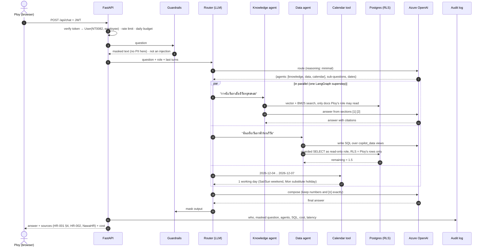

# Architecture: one question, end to end

Example: Ploy (employee, `NT0082`) asks *"ลาวันศุกร์ที่ 4 ธ.ค. แล้ววันจันทร์เป็นวันหยุดชดเชย นับลากี่วัน ฉันเหลือพอไหม"*
("If I take Friday 4 Dec off and Monday is a substitute holiday, how many leave days is that, and do I have enough?").

## Where each decision is enforced
| Concern | Enforced by | Not by |
|---|---|---|
| Who is asking | signed JWT → `User` re-read from HR data each request | anything in the chat text |
| Which documents can be retrieved | `access_roles` filter inside the SQL of the retriever | the prompt |
| Which rows can be read | Postgres RLS + read-only role + view/function allowlist | the generated SQL being "nice" |
| What can be written | MCP server permission check on the real call, after user confirmation | the model's plan |
| Numbers (day counts, balances) | code and SQL results, copied verbatim by compose | model arithmetic |
| PII in prompts/logs | `guardrails.check_input` before anything leaves the API | model instructions |

## Components
| Component | File | Notes |
|---|---|---|
| Router | `orchestrator.py` `router_node` | one small call; regex guards stop over-routing to action/summary |
| Knowledge | `agents/knowledge.py`, `kb/` | hybrid retrieval + relevance gate → may answer "not found" without an LLM call |
| Data | `agents/data.py`, `data/` | Text-to-SQL, one self-correction retry |
| Calendar | `tools/calendar.py` | deterministic working-day count |
| Summary | `agents/summary.py` | ticket summary + `pg_trgm` similar resolved cases |
| Action | `agents/action.py`, `nawadesk_mcp/` | MCP tools; read tools run, write tools pause the graph (`interrupt()`) |
| Compose | `orchestrator.py` `compose_node` | skipped when only one agent answered |
| API / UI | `api/app.py`, `api/static/` | JWT, rate limit, daily budget, CSP |
| Audit | `audit.py`, `db/init/005_security.sql` | append-only by trigger |
| Tracing | `tracing.py` | Langfuse, off without keys |
